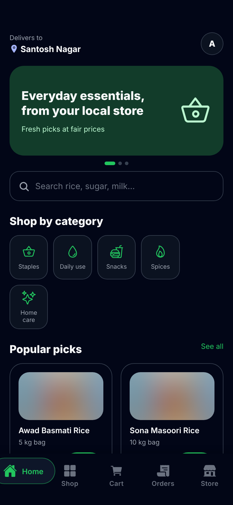
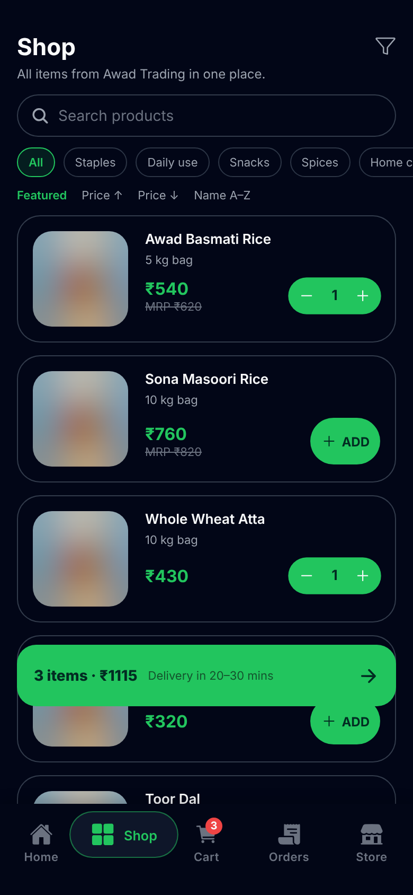
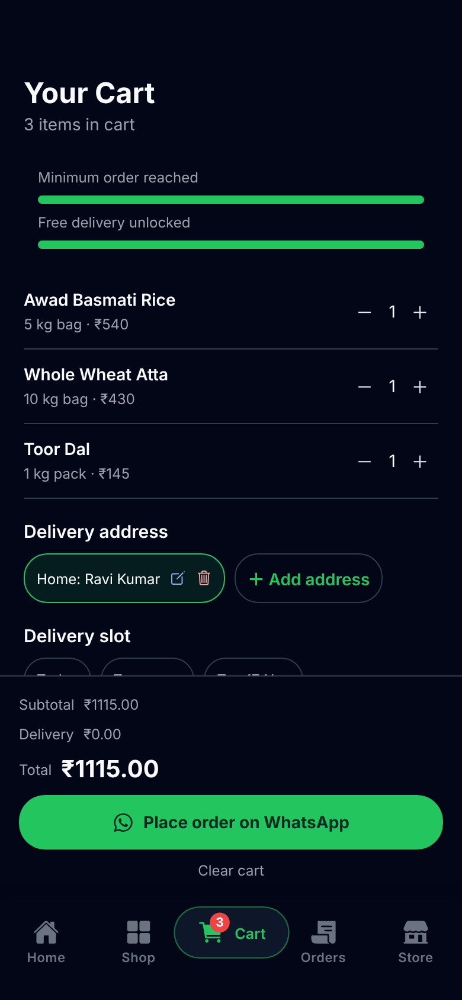
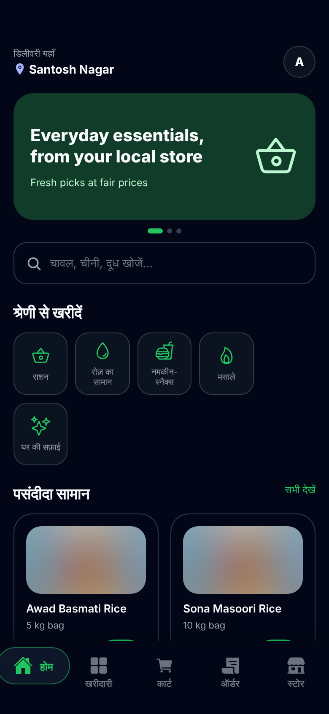

# Awad Trading — Grocery Store App

[](https://github.com/abhinavkdeval08-design/Demo-Grocery-Store/actions/workflows/lint.yml)


A mobile ordering app for a neighbourhood grocery store. Customers browse products, build a cart, pick a delivery slot and place the order, which arrives on the shop's **WhatsApp** as a ready-to-read message. The shop owner manages prices from a **Google Sheet** and keeps a customer **khata** (credit ledger) inside the app.

There is no backend to run or pay for. Hindi and English are both supported.

<p align="center">
  
  
  
  
</p>

## Features

**For customers**
- Browse by category, search, sort by price or name; MRP and savings shown
- Cart with quantity stepper, persisted across app restarts
- "Buy again" and "Repeat last order"
- Checkout with saved addresses, pincode check, delivery date and slot (with cutoff times)
- Coupons, minimum order (₹500), free delivery above ₹999, delivery fee otherwise
- Cash on delivery or UPI (with a confirm step)
- Order history with reorder
- Hindi / English switch

**For the owner**
- Update products and prices by editing a Google Sheet. No app update needed
- Cart is reconciled automatically when prices change or items go out of stock
- PIN-protected owner mode with a khata ledger per customer
- Khata backup export and import
- Full guide in English and Hindi: [docs/OWNER_GUIDE.md](docs/OWNER_GUIDE.md)

**Engineering**
- Offline-friendly: catalog is cached and refreshed in the background
- Error boundary with a bilingual fallback screen
- ESLint, TypeScript and Jest run on every push (GitHub Actions)
- EAS build profiles for Android APK / app bundle

## Tech stack

Expo SDK 54 · React Native · expo-router · TypeScript · React Context · AsyncStorage · expo-secure-store · expo-crypto · expo-image · Jest (jest-expo)

## Getting started

```bash
git clone https://github.com/abhinavkdeval08-design/Demo-Grocery-Store.git
cd Demo-Grocery-Store
npm install
npx expo start        # press a / i / w, or scan the QR code with Expo Go
```

## Configuration

Store details live in [`config/store.ts`](config/store.ts). Secrets and per-environment values can be set with environment variables; copy `.env.example` to `.env`:

| Variable | Purpose |
| --- | --- |
| `EXPO_PUBLIC_WHATSAPP_NUMBER` | Number that receives orders (country code + number, digits only) |
| `EXPO_PUBLIC_UPI_ID` | UPI ID shown at checkout |
| `EXPO_PUBLIC_CATALOG_URL` | Published Google Sheet CSV or JSON URL. Empty = use the bundled `data/products.ts` |

**Before going live, replace:** WhatsApp number, UPI ID, phone numbers, address, service pincodes, delivery slots and timings, and the bundle id in `app.json` (`com.awadtrading.store` is a placeholder). Values currently in the repo are samples.

### Live catalog from Google Sheet
1. Make a sheet with columns `id, name, price, mrp, unit, category, image, inStock, description` (see [docs/sample-catalog.csv](docs/sample-catalog.csv)).
2. File → Share → Publish to web → CSV, and copy the link into `EXPO_PUBLIC_CATALOG_URL`.
3. Edit prices in the sheet; the app picks them up on next open. Bad rows are skipped, never crash the app.

## Project structure

```
app/            Screens (expo-router): tabs, product detail, owner mode
components/     ProductCard, CartBar, PinGate, ErrorBoundary, ...
context/        Cart, Catalog, Khata, Language providers
config/         Store settings
data/           Bundled products, coupons, banners
i18n/           English and Hindi dictionaries, useT()
services/       Catalog fetching and caching
utils/          Pure logic: cart, slots, khata, order id/message, parsing
__tests__/      Jest tests
docs/           Owner guide, sample catalog, screenshots
```

## Scripts

| Command | What it does |
| --- | --- |
| `npm start` | Start the Expo dev server |
| `npm run lint` | ESLint |
| `npm run typecheck` | `tsc --noEmit` |
| `npm test` | Run the Jest suite (54 tests) |
| `npm run test:coverage` | Tests with coverage for `utils`, `services`, `i18n`, coupons |

## Building an APK

```bash
npm i -g eas-cli
eas login
npx eas build -p android --profile preview      # installable APK
npx eas build -p android --profile production   # Play Store bundle
```

## Known limitations

Being upfront about what this app does not do yet:

- **No backend.** Orders are sent to WhatsApp; there is no order database or order-status tracking for customers.
- **UPI is not verified.** The app shows the UPI ID and asks the customer to confirm; the owner must check the payment manually.
- **Khata lives only on the owner's phone.** Use the backup export regularly.
- **Translations are partial.** Owner screens, banners, store text and slot labels are still English.
- Tested via unit tests and a web build; do a pass on a real Android device before launch.

## Roadmap

- Order database and customer order tracking
- Payment gateway with automatic confirmation
- Push notifications for order updates
- Complete Hindi coverage and product names in Hindi

## Contributing

Issues and PRs are welcome. Run `npm run lint && npm run typecheck && npm test` before opening a PR.

## License

No license has been chosen yet. All rights reserved by the owner until one is added.
